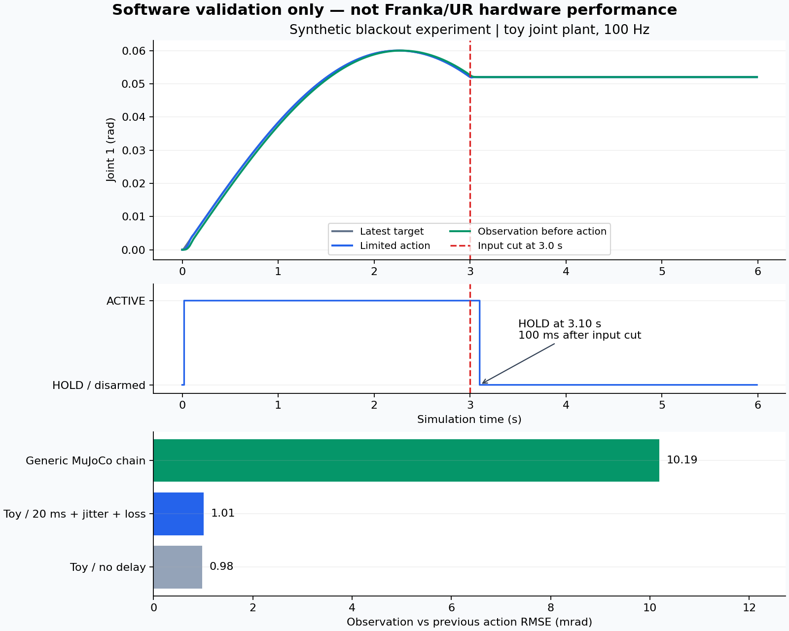

# 软件验收报告

验证日期：2026-09-29。结论：本次软件原型测试通过，未进行真实 Franka/UR/GELLO、真实局域网或跨地域实验。

## 测试环境与范围

- Python 3.12.14，NumPy 2.3.5，MuJoCo 3.3.7。
- 系统：Linux-6.18.44-x86_64-with-glibc2.39。
- 23 项单元/集成测试通过，包含独立的双进程 UDP 测试。完整输出见 `tests.txt`。
- 7 项场景验收条件全部通过。原始数值见 `validation.json`，本机网络数值见 `loopback.json`。
- 600 s 是**模拟时间**，实际计算耗时 11.16 s，不能写成“实机连续稳定运行10分钟”。

## 本机双进程实测

| 指标 | 本次值 | 解释 |
|---|---:|---|
| 服务器实际频率 | 99.34 Hz | 约5 s测量，Python仿真服务器 |
| 周期间隔 P95 | 10.14 ms | 机器人进程单调时钟测量 |
| 指令确认延迟 P95 | 10.59 ms | 从发送到收到确认状态，含服务器调度周期 |
| 最后接受指令至 HOLD | 119.99 ms | 不是机械臂真实制动时间 |
| 接受指令 | 301 | 虚拟客户端发送3 s |
| 周期超时计数 | 1 | 调度延误时跳过追赶式突发执行 |

这里的确认延迟**不是单向网络延迟**，也不包含物理机械臂和视频。该次运行有一次循环未能在计划时刻前完成，Python不具有硬实时保证；本次未触发控制周期 FAULT。最终客户端退出，服务器进入 HOLD/input_timeout。

## 离散网络仿真实验

| 场景 | 总步数 | ACTIVE步数 | 最终状态 | 接受样本到接收 P95 / ms |
|---|---:|---:|---|---:|
| 无网络延迟注入 | 600 | 600 | ACTIVE | 0.00 |
| 单向20 ms、抖动5 ms、每方向5%丢包 | 600 | 595 | ACTIVE | 30.00 |
| 3 s停止输入 | 600 | 308 | HOLD | 10.00 |
| 单向100 ms，超过有效期预算 | 300 | 0 | DISARMED | — |
| MuJoCo通用关节链 | 600 | 598 | ACTIVE | 10.00 |
| MuJoCo按真实时间播放 | 600 | 598 | ACTIVE | 10.00 |
| 600 s加速仿真 | 60000 | 59998 | ACTIVE | 10.00 |

网络模型：每方向独立高斯抖动，负延迟裁为0；每方向独立随机丢包。固定种子7。事件在100 Hz控制步上处理，因此模拟时延量化为10 ms。P95仅统计接受的指令，必须结合接受/拒绝数量解释，不能据此掩盖可用性损失。

断流场景在模拟时刻3.0 s停止产生新输入，3.10 s进入HOLD，即100 ms。120 ms机器人端有效期比150 ms接收看门狗更早触发。单向100 ms场景中往返超过预算，全部运动指令拒绝且未使能；这证明过期保护行为，不代表平台支持该网络条件。

## 跟踪误差的解释

一阶模型无延迟时，执行前观测相对上一拍已下发动作的RMSE为 0.978 mrad。MuJoCo通用链为 10.187 mrad。

两个模型动力学不同，上述值用于确认记录和评测程序工作，不用于比较算法优劣，也不能代表Franka/UR的真实精度。没有末端位姿外部测量、夹爪接触模型或真实工具标定；没有“毫米级精度已实现”的依据。



## 已发现并修正的问题

1. 初始仿真夹爪值为NumPy标量，与严格消息类型校验不一致，导致命令被拒绝；统一转换为Python浮点数后通过。
2. 600 s加速仿真的数据产生速度超过异步写盘吞吐，原实现显式报队列满；离线模式增加有界背压等待，在线模式保留不阻塞和显式错误路径。
3. 完善数值类型验证，拒绝NaN、错误长度、字符串角度、布尔角度及超大整数，防止非预期输入进入控制。

## 未验收项目

真实机械臂模型与碰撞、动力学标定、串口GELLO、Franka/UR驱动、实体急停/使能、实际减速和停止距离、硬件长期稳定性、局域网/WAN、视频回传、状态/相机同步、物理夹爪、任务成功标签和模仿学习训练均未验收。MuJoCo窗口未人工验证，已验证的是无窗口计算接口。

## 复现

在工程根目录安装依赖后运行：

```bash
python -m unittest discover -s tests -v
python -m examples.validate --output runs/validation
python -m examples.loopback_validation --output runs/loopback
# 可选绘图；需要自行安装 matplotlib
python -m examples.plot_results --run-dir runs/validation --output runs/validation.png
```

运行时间和本机延迟受硬件/操作系统负载影响；不要要求其他机器逐位复现墙钟时间。无实时节拍的离线生成可以等待磁盘，其每步耗时不能外推为实时伺服性能。完整数据样例见工程根目录 `sample_episode/` 和 `sample_episode.npz`，明确标为合成数据。
